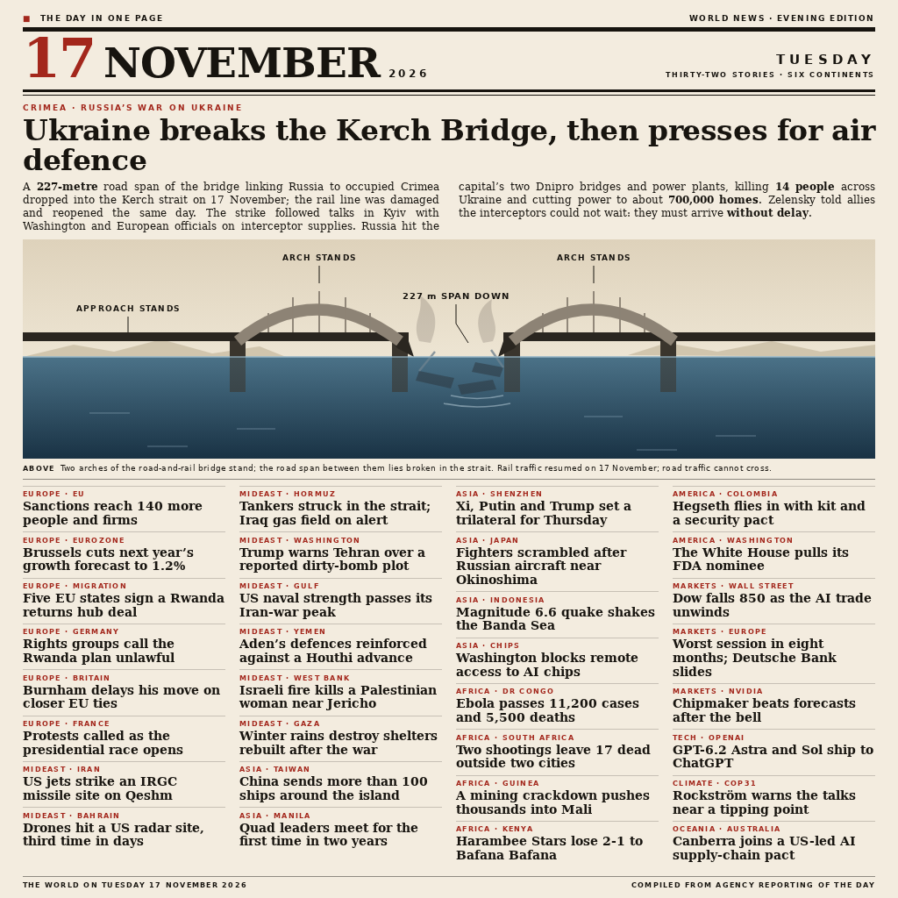

# The Day in One Page — 17 November 2026

[](https://make.fun/c/news-image-20261117)
[](https://make.fun/c/news-image-20261117)
[](https://make.fun/c/news-image-20261117)

An entry in [Sum up 17 November's world news in one image](https://make.fun/c/news-image-20261117) on make.fun.



A single broadsheet front page for Tuesday 17 November 2026, composed as an
HTML/CSS/SVG sheet and rendered to 1024×1024. It carries the day's lead — the
Kerch Bridge road span lost into the strait, the rail line back the same day,
Kyiv's fresh talks in Washington and Europe, and the strike on the capital's
Dnipro bridges — as a labelled elevation, above a four-column grid of
thirty-two further headlines from six continents: the sanctions round and the Rwanda
returns hub, Iran's drones at Bahrain and the Qeshm strike, the tankers hit in
Hormuz, Taiwan's encirclement, the Banda Sea quake, the Shenzhen trilateral,
Ebola in DR Congo, the South African shootings, the AI-trade selloff and
Nvidia's beat, COP31's tipping-point warning, and winter in Gaza.

## Run it

```
mkdir -p out && MAKEFUN_OUTPUT_DIR=out python3 main.py
```

`main.py` is the entry's runtime. It reads the finished `entry.png` beside it,
checks it against the competition guardrails (a PNG, exactly 1024×1024, at most
1 MiB) and writes it to `/output/entry.png`. Standard library only, no network,
no clock and no randomness, so the two runs the grader makes write the same
bytes.

`poster.html` is the source the image was rendered from, kept so the page can be
re-rendered or edited. It is not read at run time.

## Layout

- masthead: date, straps, double rule
- lead: kicker, headline, standfirst, and the bridge elevation with labels
- grid: four columns × eight rows of tagged one-line headlines
- footer rule and colophon

Palette: paper `#f3ecdf`, ink `#17140f`, red `#b3241c`, sea `#3d6884`–`#12283a`.

## Licence

MIT — see [LICENSE](LICENSE).
